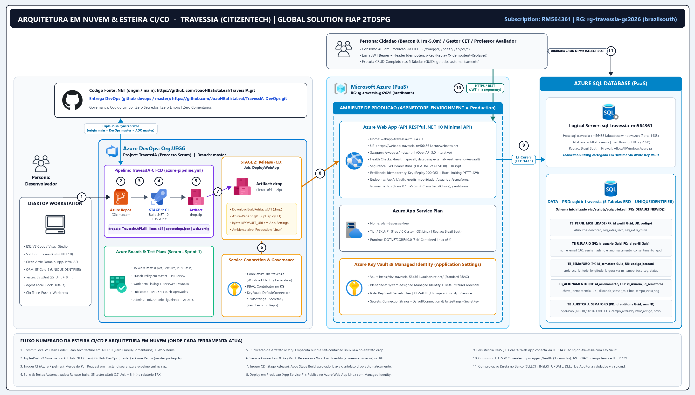

# TravessIA API — DevOps Tools & Cloud Computing

**Disciplina:** DevOps Tools & Cloud Computing — Global Solution 2026/2  
**Turma:** 2TDSPG  

---

## 1. Integrantes do Grupo

Joao Henrique Batista Leal - RM 564361  
Erik Naoki Miyasato - RM 565771  
Juliana da Silva Stigliani - RM 561171  
Gutemberg Rocha Silva - RM 562267  
Gustavo Arthur Carvalho Sartori - RM 561650  

---

## 2. Links Oficiais da Entrega

| Recurso | URL / Identificacao Oficial |
|---|---|
| **URL Base no Azure Web App** | `https://webapp-travessia-rm564361.azurewebsites.net` |
| **Swagger UI em Producao** | `https://webapp-travessia-rm564361.azurewebsites.net/swagger/index.html` |
| **Health Check em 3 Camadas (`/health`)** | `https://webapp-travessia-rm564361.azurewebsites.net/health` |
| **Projeto no Azure DevOps** | `https://dev.azure.com/OrgJJEGG/TravessIA` |
| **Repositorio GitHub DevOps — Branch `master`** | `https://github.com/JoaoHBatistaLeal/TravessIA-DevOps` |
| **Repositorio GitHub .NET — Branch `main`** | `https://github.com/JoaoHBatistaLeal/TravessIA` |
| **Video de Demonstracao no YouTube** | `https://youtu.be/<url>` |

---

## 3. Descricao da Solucao CitizenTech TravessIA e Beneficios para o Negocio

O **TravessIA** e uma plataforma de semaforos inteligentes e mobilidade urbana inclusiva projetada para aumentar a seguranca de pedestres vulneraveis em travessias urbanas. Nos semaforos convencionais, o tempo fixo de fase verde para pedestres considera apenas a marcha padrao de um adulto sem restricoes em pista seca, elevando o risco de acidentes e quedas para idosos, cadeirantes ou cidadaos com mobilidade reduzida, especialmente em avenidas largas e sob chuva ou tempestade.

A API em nuvem integra sensores fisicos de proximidade instalados na calcada que validam e liberam solicitacoes de travessia exclusivamente dentro do raio seguro de **`0.1m` a `5.0m`**, conforme as constantes `MinSensorDistanceMeters = 0.1m` e `MaxSensorDistanceMeters = 5.0m`, calculando dinamicamente a extensao do tempo verde de acordo com:
- **Perfis de mobilidade prioritaria**: `PADRAO` com 0s seco e 4s chuva, `IDOSO` com 6s seco e 12s chuva, `CADEIRANTE` com 8s seco e 15s chuva, e `MOBILIDADE_REDUZIDA` com 5s seco e 10s chuva.
- **Telemetria climatica em tempo real**: diferencia `SECO` de `CHUVA_MODERADA` e `TEMPESTADE`, aplicando bonus de seguranca de `+5s` em `TEMPESTADE` ou chuva acima de `20mm`.
- **Geometria viaria**: acrescenta segundos proporcionais a largura da avenida atravessada registrada em `largura_via_m`.
- **Conformidade LGPD**: exige `consentimento_lgpd = 'S'` para liberar o acionamento e registra justificativa explicavel no campo `justificativa_ia`.

### Beneficios Diretos de DevOps, DevSecOps e Cloud Computing
- **Entrega Continua na Branch `master`**: Cada Pull Request aprovado e mesclado na branch protegida `master` do Azure Repos dispara automaticamente o pipeline multiestagio definido em `azure-pipeline.yml`, executando `Build` e `Release` sem deploys manuais sujeitos a erro humano.
- **Quality Gate Automatizado com 35 Testes xUnit**: O estagio de CI executa os **35 testes automatizados** — 27 unitarios de dominio e 8 de integracao end-to-end — com publicacao de relatorio TRX via `PublishTestResults@2` e cobertura, impedindo que qualquer regressao chegue ao ambiente de producao.
- **Seguranca DevSecOps Zero-Secrets**: Nenhuma string de conexao SQL ou chave JWT e armazenada em codigo-fonte ou em `appsettings.json`. Em runtime, o Web App `webapp-travessia-rm564361` autentica-se no cofre **Azure Key Vault `kv-travessia-564361`** por meio de **System-Assigned Managed Identity** e `DefaultAzureCredential` sob politica RBAC `Key Vault Secrets User`.
- **Otimizacao de Custos em Nuvem**: Provisionamento padronizado via Azure CLI em `/scripts/provision-azure.sh` utilizando o plano `plan-travessia-free` no tier gratuito `F1` Linux em `brazilsouth`, viabilizando operacao continua com custo zero de computacao web e alta reprodutibilidade de infraestrutura como codigo.

---

## 4. Stack Tecnologica

| Camada / Componente | Tecnologia / Servico | Especificacao no Projeto TravessIA |
|---|---|---|
| **Plataforma e API** | `.NET 10.0 SDK` | Minimal APIs ASP.NET Core, Clean Architecture, EF Core `9.0.14`, Swagger/Swashbuckle `7.2.0` |
| **Testes Automatizados** | `xUnit 2.9.3` | `TravessIA.Tests` com 35 testes — 27 Unitarios e 8 de Integracao em `WebApplicationFactory<Program>` |
| **Computacao Web PaaS** | `Azure App Service Linux` | Web App `webapp-travessia-rm564361` no App Service Plan `plan-travessia-free`, SKU `F1`, regiao `brazilsouth` |
| **Banco de Dados PaaS** | `Azure SQL Database PaaS` | Servidor logico `sql-travessia-rm564361.database.windows.net`, banco `sqldb-travessia` Basic 5 DTUs / 2 GB |
| **Cofre de Segredos DevSecOps** | `Azure Key Vault` | `kv-travessia-564361` Standard com RBAC ativado em `https://kv-travessia-564361.vault.azure.net/` |
| **Esteira CI/CD** | `Azure Pipelines` | Definida em `azure-pipeline.yml` executando no Pool `Default` com gatilho na branch `master` |
| **Controle de Versao e Governanca** | `GitHub + Azure Repos` | Branch `master` protegida no Azure Repos com Branch Policies e Work Item Linking; espelho em `TravessIA-DevOps` e codigo `.NET` em `TravessIA` |
| **Autenticacao Azure CI/CD** | `Service Connection` | `azure-rm-travessia` via Workload Identity Federation com papel `Contributor` em `rg-travessia-gs2026` |
| **Infraestrutura como Codigo IaC** | `Azure CLI` | Script idempotente `/scripts/provision-azure.sh` + DDL e Seed em `/scripts/script-bd.sql` |
| **Conteinerizacao** | `Docker` | Multi-stage build Linux non-root em `/dockerfiles/Dockerfile` baseado em `aspnet:10.0` e `sdk:10.0` na porta `8080` |

---

## 5. Diagrama da Arquitetura e Fluxo CI/CD Numerado



| Passo | Etapa do Fluxo | Descricao Tecnica da Execucao |
|---|---|---|
| **1** | **Commit Local e Worktrees** | Desenvolvedor implementa evolucoes na Clean Architecture `.NET 10.0`, valida testes locais e vincula commits aos Work Items do Azure Boards. |
| **2** | **Dual-Push Sincronizado na Branch `master`** | Alteracoes de entrega DevOps sao enviadas para a branch protegida `master` no Azure Repos e no GitHub `TravessIA-DevOps`, mantendo o codigo `.NET` sincronizado no repositorio `TravessIA` na branch `main`. |
| **3** | **Gatilho CI na `master`** | O merge de Pull Request aprovado na branch `master`, atendendo as Branch Policies e vinculacao de Work Item, aciona automaticamente o Stage `Build` do pipeline `TravessIA-CI-CD`. |
| **4** | **Build .NET 10 e 35 Testes xUnit TRX** | O agente no Pool `Default` configura `.NET 10.0.x` via `UseDotNet@2`, restaura pacotes, compila em `Release`, executa os 35 testes `xUnit` e publica resultados TRX com cobertura. |
| **5** | **Publicacao de Artefato `drop.zip`** | A etapa `DotNetCoreCLI@2` publica `TravessIA.API` como bundle `linux-x64` self-contained em `.zip` e registra o artefato imutavel `drop` via `PublishBuildArtifacts@1`. |
| **6** | **Service Connection e Azure Key Vault** | A Service Connection `azure-rm-travessia` via Workload Identity Federation autoriza o deploy no Resource Group `rg-travessia-gs2026`, enquanto o Web App le segredos do `kv-travessia-564361` via Managed Identity. |
| **7** | **Gatilho CD Stage Release** | Apos a conclusao com sucesso do Stage `Build`, o Stage `Release` baixa o artefato `drop` automaticamente via `DownloadBuildArtifacts@1`. |
| **8** | **Deploy Azure App Service Linux `F1`** | A task `AzureWebApp@1` realiza o ZipDeploy no `webapp-travessia-rm564361` injetando `KEYVAULT_URI` e `ASPNETCORE_ENVIRONMENT=Production` nas App Settings. |
| **9** | **Persistencia PaaS EF Core 9 no Azure SQL** | A API em producao conecta-se via TLS/TCP `1433` ao servidor `sql-travessia-rm564361.database.windows.net` no banco `sqldb-travessia` usando EF Core 9 e a connection string obtida do Key Vault. |
| **10** | **Consumo HTTPS Swagger, Health e CRUD** | Cidadaos, gestores e avaliadores consomem `/swagger/index.html`, `/health` e `/api/v1/*` com autenticacao Bearer JWT, idempotencia via `Idempotency-Key` e Rate Limiting retornando `HTTP 429`. |
| **11** | **Auditoria Direta no Banco via `SELECT` SQL** | Validacao direta da persistencia em nuvem por meio de consultas `SELECT` no Azure SQL Database comprovando registros `INSERT`, `UPDATE`, `DELETE` e trilha de auditoria. |

---

## 6. Estrutura do Banco de Dados em Nuvem, Queries `SELECT` e Payloads JSON CRUD

O esquema relacional provisionado em `sqldb-travessia` por meio de `/scripts/script-bd.sql` utiliza chaves primarias `UNIQUEIDENTIFIER` com `DEFAULT NEWID()` em todas as **5 tabelas**, garantindo unicidade distribuida sem colisoes:

1. **`dbo.TB_PERFIL_MOBILIDADE`**: Armazena os perfis prioritarios `id_perfil` como PK `UNIQUEIDENTIFIER`, `codigo` como UK `VARCHAR(30)`, `descricao`, `seg_extra_seco` e `seg_extra_chuva`, com carga inicial deterministica para `PADRAO`, `IDOSO`, `CADEIRANTE`, `DEFICIENCIA_VISUAL` e `MOBILIDADE_REDUZIDA`.
2. **`dbo.TB_USUARIO`**: Armazena cidadaos e gestores `id_usuario` como PK `UNIQUEIDENTIFIER`, `id_perfil` como FK para `TB_PERFIL_MOBILIDADE`, `nome`, `email` como UK, `senha_hash` em BCrypt, `role` entre `CIDADAO` ou `GESTOR`, `ano_nascimento`, `consentimento_lgpd` como `'S'` ou `'N'`, e `dt_cadastro`.
3. **`dbo.TB_SEMAFORO`**: Armazena os cruzamentos equipados com beacons IoT `id_semaforo` como PK `UNIQUEIDENTIFIER`, `codigo_beacon` como UK, `endereco`, `latitude`, `longitude`, `largura_via_m`, `tempo_base_seg` e `status_operacional` entre `ATIVO`, `MANUTENCAO` ou `MODO_CHUVA`, com carga inicial para `BEACON-SP-001`, `BEACON-SP-002` e `BEACON-SP-003`.
4. **`dbo.TB_ACIONAMENTO`**: Persiste cada requisicao inteligente de travessia `id_acionamento` como PK `UNIQUEIDENTIFIER`, `id_usuario` como FK, `id_semaforo` como FK, `chave_idempotencia` como UK `VARCHAR(100)`, `dt_hora`, `distancia_sensor_m`, `condicao_clima`, `intensidade_chuva_mm`, `tempo_extra_seg` e `justificativa_ia`.
5. **`dbo.TB_AUDITORIA_SEMAFORO`**: Trilha imutavel de auditoria `id_auditoria` como PK `UNIQUEIDENTIFIER`, `id_semaforo` como `UNIQUEIDENTIFIER` **sem FK**, `operacao` entre `INSERT`, `UPDATE` ou `DELETE`, `campo_alterado`, `valor_antigo`, `valor_novo`, `usuario_bd` e `dt_operacao`. A ausencia de chave estrangeira preserva integralmente o historico de operacoes `INSERT`, `UPDATE` e `DELETE` mesmo apos a exclusao fisica de um semaforo em `TB_SEMAFORO`.

### Queries `SELECT` para Comprovacao de Persistencia em Nuvem

```sql
SELECT * FROM TB_PERFIL_MOBILIDADE;
SELECT id_usuario, id_perfil, nome, email, role, ano_nascimento, consentimento_lgpd, dt_cadastro FROM TB_USUARIO;
SELECT * FROM TB_SEMAFORO;
SELECT * FROM TB_ACIONAMENTO;
SELECT * FROM TB_AUDITORIA_SEMAFORO;
```

### Payloads JSON CRUD Completos sem GUIDs Manuais no Corpo da Requisicao

#### 6.1. Autenticacao Previa — `POST /api/v1/auth/login`

**Request Body:**
```json
{
  "email": "gestor@travessia.com.br",
  "senha": "Admin@TravessIA2026"
}
```

#### 6.2. CRUD `TB_PERFIL_MOBILIDADE` — `/api/v1/perfis-mobilidade`

- **POST `/api/v1/perfis-mobilidade` — Bearer Token `GESTOR`, retorna `201 Created`**

**Request Body:**
```json
{
  "codigo": "GESTANTE",
  "descricao": "Gestante ou pessoa com crianca de colo",
  "segExtraSeco": 6,
  "segExtraChuva": 12
}
```

**Response (`201 Created`):**
```json
{
  "idPerfil": "7d5a4af8-6cef-4733-8fdd-e6d52598b189",
  "codigo": "GESTANTE",
  "descricao": "Gestante ou pessoa com crianca de colo",
  "segExtraSeco": 6,
  "segExtraChuva": 12
}
```

- **GET `/api/v1/perfis-mobilidade` e GET `/api/v1/perfis-mobilidade/{id}` — retorna `200 OK`**

**Response (`200 OK`):**
```json
{
  "idPerfil": "7d5a4af8-6cef-4733-8fdd-e6d52598b189",
  "codigo": "GESTANTE",
  "descricao": "Gestante ou pessoa com crianca de colo",
  "segExtraSeco": 6,
  "segExtraChuva": 12
}
```

- **PUT `/api/v1/perfis-mobilidade/{id}` — Bearer Token `GESTOR`, retorna `200 OK`**

**Request Body:**
```json
{
  "codigo": "GESTANTE",
  "descricao": "Gestante ou pessoa com crianca de colo em travessia prioritaria",
  "segExtraSeco": 6,
  "segExtraChuva": 14
}
```

**Response (`200 OK`):**
```json
{
  "idPerfil": "7d5a4af8-6cef-4733-8fdd-e6d52598b189",
  "codigo": "GESTANTE",
  "descricao": "Gestante ou pessoa com crianca de colo em travessia prioritaria",
  "segExtraSeco": 6,
  "segExtraChuva": 14
}
```

- **DELETE `/api/v1/perfis-mobilidade/{id}` — Bearer Token `GESTOR`, retorna `204 No Content`**

#### 6.3. CRUD `TB_SEMAFORO` — `/api/v1/semaforos`

- **POST `/api/v1/semaforos` — Bearer Token `GESTOR`, retorna `201 Created` e grava `INSERT` em `TB_AUDITORIA_SEMAFORO`**

**Request Body:**
```json
{
  "codigoBeacon": "BEACON-SP-010",
  "endereco": "Av. Paulista, 1106",
  "latitude": -23.5641,
  "longitude": -46.6524,
  "larguraViaM": 14.0,
  "tempoBaseSeg": 15,
  "statusOperacional": "ATIVO"
}
```

**Response (`201 Created`):**
```json
{
  "idSemaforo": "684c855b-3ddb-4650-bf08-0653703307d9",
  "codigoBeacon": "BEACON-SP-010",
  "endereco": "Av. Paulista, 1106",
  "latitude": -23.5641,
  "longitude": -46.6524,
  "larguraViaM": 14.0,
  "tempoBaseSeg": 15,
  "statusOperacional": "ATIVO"
}
```

- **GET `/api/v1/semaforos` e GET `/api/v1/semaforos/{id}` — retorna `200 OK`**

**Response (`200 OK`):**
```json
{
  "idSemaforo": "684c855b-3ddb-4650-bf08-0653703307d9",
  "codigoBeacon": "BEACON-SP-010",
  "endereco": "Av. Paulista, 1106",
  "latitude": -23.5641,
  "longitude": -46.6524,
  "larguraViaM": 14.0,
  "tempoBaseSeg": 15,
  "statusOperacional": "ATIVO"
}
```

- **PUT `/api/v1/semaforos/{id}` — Bearer Token `GESTOR`, retorna `200 OK` e grava `UPDATE` em `TB_AUDITORIA_SEMAFORO`**

**Request Body:**
```json
{
  "codigoBeacon": "BEACON-SP-010",
  "endereco": "Av. Paulista, 1106 - Bela Vista, Sao Paulo - SP",
  "latitude": -23.5641,
  "longitude": -46.6524,
  "larguraViaM": 16.0,
  "tempoBaseSeg": 20,
  "statusOperacional": "MODO_CHUVA"
}
```

**Response (`200 OK`):**
```json
{
  "idSemaforo": "684c855b-3ddb-4650-bf08-0653703307d9",
  "codigoBeacon": "BEACON-SP-010",
  "endereco": "Av. Paulista, 1106 - Bela Vista, Sao Paulo - SP",
  "latitude": -23.5641,
  "longitude": -46.6524,
  "larguraViaM": 16.0,
  "tempoBaseSeg": 20,
  "statusOperacional": "MODO_CHUVA"
}
```

- **DELETE `/api/v1/semaforos/{id}` — Bearer Token `GESTOR`, retorna `204 No Content` e preserva trilha `INSERT`/`UPDATE`/`DELETE` em `TB_AUDITORIA_SEMAFORO`**

#### 6.4. CRUD `TB_ACIONAMENTO` — `/api/v1/acionamentos`

- **POST `/api/v1/acionamentos` — Bearer Token `CIDADAO` ou `GESTOR` e header `Idempotency-Key`, retorna `201 Created` na primeira execucao ou `200 OK` com `X-Idempotent-Replayed: true` no replay**

**Request Body:**
```json
{
  "codigoBeacon": "BEACON-SP-001",
  "distanciaSensorM": 1.5,
  "condicaoClima": "TEMPESTADE",
  "intensidadeChuvaMm": 25.0
}
```

**Response (`201 Created` na primeira chamada / `200 OK` no replay idempotente):**
```json
{
  "idAcionamento": "d663b7b0-edc9-4a74-b45f-85fe43968195",
  "idUsuario": "f2eab64b-3b55-4b5c-9a9d-59d40020b2f8",
  "idSemaforo": "22222222-2222-2222-2222-222222222201",
  "chaveIdempotencia": "idem-rain-1794430182",
  "dtHora": "2026-11-11T20:51:17.2725172Z",
  "distanciaSensorM": 1.5,
  "condicaoClima": "TEMPESTADE",
  "intensidadeChuvaMm": 25.0,
  "tempoExtraSeg": 30,
  "tempoBaseSeg": 15,
  "tempoTotalSeg": 45,
  "justificativaIa": "TravessIA Decision Engine: Perfil=CADEIRANTE (+15s) | Clima=TEMPESTADE (25.00mm) | LarguraVia=18.50m (+10s) | BonusTempestade=+5s | TempoBase=15s | TempoExtraConcedido=30s | TempoTotalTravessia=45s."
}
```

- **GET `/api/v1/acionamentos` e GET `/api/v1/acionamentos/{id}` — Bearer Token `CIDADAO` ou `GESTOR`, retorna `200 OK`**

- **PUT `/api/v1/acionamentos/{id}` — Bearer Token `CIDADAO` ou `GESTOR`, retorna `200 OK`**

**Request Body:**
```json
{
  "codigoBeacon": "BEACON-SP-001",
  "distanciaSensorM": 2.2,
  "condicaoClima": "CHUVA_MODERADA",
  "intensidadeChuvaMm": 14.5
}
```

**Response (`200 OK`):**
```json
{
  "idAcionamento": "4c2d2ce8-31eb-498f-bf98-5d10a3e0ae69",
  "idUsuario": "f2eab64b-3b55-4b5c-9a9d-59d40020b2f8",
  "idSemaforo": "22222222-2222-2222-2222-222222222201",
  "chaveIdempotencia": "idem-dry-1794430182",
  "dtHora": "2026-11-11T20:51:16.990005Z",
  "distanciaSensorM": 2.2,
  "condicaoClima": "CHUVA_MODERADA",
  "intensidadeChuvaMm": 14.5,
  "tempoExtraSeg": 25,
  "tempoBaseSeg": 15,
  "tempoTotalSeg": 40,
  "justificativaIa": "TravessIA Decision Engine: Perfil=CADEIRANTE (+15s) | Clima=CHUVA_MODERADA (14.50mm) | LarguraVia=18.50m (+10s) | BonusTempestade=+0s | TempoBase=15s | TempoExtraConcedido=25s | TempoTotalTravessia=40s."
}
```

- **DELETE `/api/v1/acionamentos/{id}` — Bearer Token `GESTOR`, retorna `204 No Content`**

---

## 7. Variaveis de Ambiente Protegidas e Azure Key Vault

| Variavel / Segredo | Onde e Configurada | Funcao e Governanca de Seguranca |
|---|---|---|
| `KEYVAULT_URI` | App Settings do Web App e Pipeline CD | Endereco do cofre `https://kv-travessia-564361.vault.azure.net/` lido pelo `Program.cs` via `AddAzureKeyVault` e `DefaultAzureCredential` |
| `ConnectionStrings--DefaultConnection` | Segredo no Azure Key Vault `kv-travessia-564361` | String de conexao TLS ao Azure SQL Server `sql-travessia-rm564361.database.windows.net` no banco `sqldb-travessia`, nunca versionada no Git |
| `JwtSettings--SecretKey` | Segredo no Azure Key Vault `kv-travessia-564361` | Chave simetrica HMAC-SHA256 para assinatura e validacao dos tokens JWT Bearer com emissor `TravessIA` e audiencia `TravessIA.API` |
| `ASPNETCORE_ENVIRONMENT` | App Settings do Web App como `Production` | Controla comportamento de producao mantendo Swagger UI e `/health` ativos para avaliacao e monitoramento |
| **Managed Identity RBAC** | `webapp-travessia-rm564361` para `kv-travessia-564361` | Identidade gerenciada atribuida ao sistema com papel **`Key Vault Secrets User`** para leitura sem credenciais estaticas |

---

## 8. Estrutura de Diretorios do Repositorio

```text
TravessIA/
├── .dockerignore
├── .editorconfig
├── .gitignore
├── azure-pipeline.yml
├── global.json
├── README.md
├── TravessIA.sln
├── dockerfiles/
│   └── Dockerfile
├── docs/
│   └── arquitetura-travessia.png
├── scripts/
│   ├── provision-azure.sh
│   └── script-bd.sql
├── TravessIA.Domain/
│   ├── Entities/
│   │   ├── Acionamento.cs
│   │   ├── AuditoriaSemaforo.cs
│   │   ├── PerfilMobilidade.cs
│   │   ├── Semaforo.cs
│   │   └── Usuario.cs
│   ├── Exceptions/
│   │   └── DomainException.cs
│   ├── Helpers/
│   │   └── HashHelper.cs
│   └── TravessIA.Domain.csproj
├── TravessIA.Application/
│   ├── Auth/
│   │   └── JwtTokenIssuer.cs
│   ├── DTOs/
│   │   ├── Acionamentos/
│   │   ├── Auditorias/
│   │   ├── Auth/
│   │   ├── PerfisMobilidade/
│   │   ├── Semaforos/
│   │   └── Usuarios/
│   ├── Repositories/
│   ├── Services/
│   │   ├── Implementations/
│   │   └── Interfaces/
│   └── TravessIA.Application.csproj
├── TravessIA.Infrastructure/
│   ├── Persistence/
│   │   ├── Configurations/
│   │   ├── Repositories/
│   │   ├── TravessIAContext.cs
│   │   └── TravessIASeeder.cs
│   └── TravessIA.Infrastructure.csproj
├── TravessIA.API/
│   ├── Endpoints/
│   ├── Exceptions/
│   ├── Extensions/
│   ├── Health/
│   ├── Program.cs
│   ├── TravessIA.API.csproj
│   ├── appsettings.Development.json
│   └── appsettings.json
└── TravessIA.Tests/
    ├── Integration/
    │   └── TravessIAIntegrationTests.cs
    ├── Unit/
    │   └── CrosswalkDomainTests.cs
    └── TravessIA.Tests.csproj
```

---

## 9. Declaracao de Uso de Inteligencia Artificial Generativa

Em conformidade com as diretrizes academicas da FIAP para a Global Solution 2026/2, declaramos que ferramentas de Inteligencia Artificial Generativa foram utilizadas como assistentes de apoio tecnico durante o desenvolvimento e a documentacao deste projeto nas seguintes frentes:

1. **Estruturacao de Codigo e Arquitetura**: Apoio na organizacao da Clean Architecture em `.NET 10.0`, configuracao das Minimal APIs, Fluent API do Entity Framework Core e padronizacao dos descritores OpenAPI/Swagger.
2. **Revisao e Validacao Humana Integral**: Todas as regras de negocio de travessia inteligente, politicas de branch na `master` do Azure Repos, configuracoes de seguranca no Azure Key Vault com `DefaultAzureCredential`, execucoes de pipeline e testes em nuvem foram integralmente inspecionados, executados e validados pelos integrantes do grupo, que assumem total responsabilidade autoral e tecnica pela entrega.
